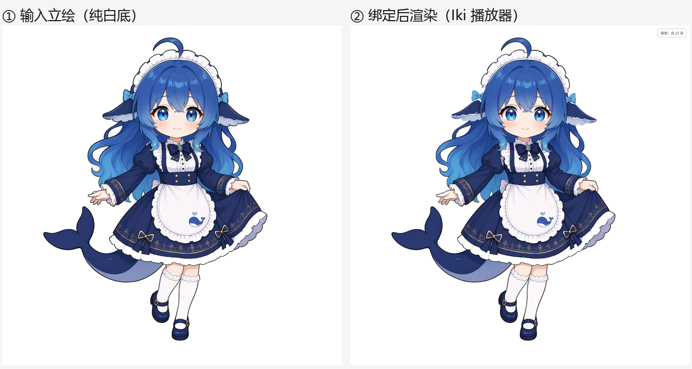
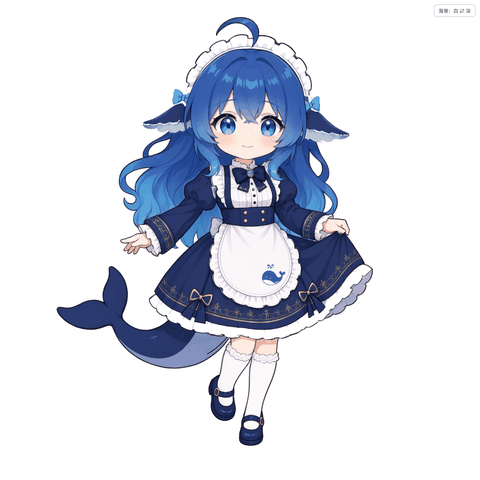

# Hermes Live2D — 单张立绘 → 会动的 2D 傀儡模型

> 一套给 **Hermes Agent** 用的 Live2D 生成技能与完整流程：把**一张**静态立绘（有没有背景都行）
> 变成能眨眼、摆头、甩尾巴、摆腿的 `.iki` 模型（Iki = 开源的 Live2D 替代格式），
> 并交付一个打开就在动的网页播放器。
>
> ⚠️ 仓库只含**代码、流程、技能**。立绘素材、模型权重不在仓库内（授权原因，见 [§7](#7-授权与引用)）。

**English**: A Hermes-Agent skill + reproducible pipeline that turns a single anime illustration
into a rigged, animated 2D model (`.iki`, the open-source Live2D alternative). Four stages:
semantic layer decomposition → post-processing → auto leg splitting → rig binding. Includes a
Hermes skill package (`skill/2d-puppet-rigging`) with the hard-won pitfalls. Assets and model
weights are not redistributed.

---

## 1. 效果





左边是**一张** JPG/PNG 立绘，右边是把它的 20 个语义部件拆开、逐个绑定枢轴与弹簧之后，
在网页播放器里的实际渲染（不是设计图，也不是「调参工具截图」）。

一个模型里能独立运动的东西：

| 部件 | 驱动 | 说明 |
|---|---|---|
| 头发（前/后） | 弹簧 + 头转 | 整块绕发根摆，不拆缕（拆了必露额头底色） |
| 耳朵（左/右） | 双弹簧 + 反号枢轴 | 两只各走各的节奏，不是跷跷板 |
| 尾巴 | 弹簧绕尾根 | 整条摆，越靠尾尖摆幅越大 |
| 腿（左/右） | 平移 + 弹簧 | 两条腿不同相位、后腿幅度 60% |
| 裙子 / 围裙 | 弹簧绕腰 | 围裙与裙子必须挂同一个 deformer（否则一个摆一个不动） |
| 脸 / 五官 / 眼白 / 虹膜 / 睫毛 / 眉 | 头总成 | 转头时整张脸跟着走，不出现「头动头发不动」 |
| 眨眼 / 嘴 / 视线 | 参数直驱 | 由播放器或 App 侧写入 |

---

## 2. 管线（四段，全部脚本化）

```
单张立绘 (PNG/JPG，可带背景)
   │
   ├─[0] 抠图（可选）  pipeline/matting/rmbg_cut.py      RMBG-1.4 via ComfyUI
   │      └─ pipeline/matting/extract_subject.py         剔碎片 → 裁 bbox → 居中正方形白底
   │
   ├─[1] 语义拆层      pipeline/run_seethrough.sh         See-through → 17 层 PSD（约 7 分钟）
   │
   ├─[2] 后处理        pipeline/postprocess.py            ★ 通用
   │      清底膜 · 分区换色 · 合层 · 补洞 · 兜底层 · 语义层序
   │
   ├─[2.5] 双腿拆分    pipeline/auto_split_legs.py        ★ 全自动，无需手调参数
   │
   └─[3] 绑定导出      pipeline/build_iki.py              ★ 通用，枢轴全部由 bbox 推导
          → model.iki  → 网页播放器 / Android App
```

★ 标记的三个脚本是**通用的**：换一张完全不同的立绘，不需要改代码、不需要改常量。

---

## 3. 实测案例

三个案例都用同一套 `postprocess.py` + `build_iki.py`，只换输入图。
「合成差」= PSD 自身合成 vs 输入原图的平均通道差（越小越好）。
「静态渲染差」= 模型在播放器里 `?nodrive=1` 冻结渲染 vs 原图，1280×1280 逐像素比。

### 案例 1 —— Q 版立绘，纯白底，无背景干扰

| 项目 | 数值 |
|---|---|
| 输入 | 1024×1024 Q 版立绘，纯白底 |
| See-through | 17 层 PSD（43MB） |
| 后处理 | **20 个部件**，合成差 **4.76** |
| 绑定 | 20 parts / 10 deformers / 8 physics |
| 静态渲染差 | **16499 px / 平均差 3.31** |
| 腿部细节 | 腿区差异 **401 px**（历史最低） |
| 双腿动态 | 腿L ±0.98° / 腿R ±1.31°，参数相关 **r=0.746**（各自动） |
| 分界缝 | 原图基准 **+4~6 px**（没被撑开） |

这个案例一共迭代了 **60 多版**（v1 → v61），绝大部分时间花在腿和边缘上。
最后稳定的方案是：**不羽化、异源输入、后腿幅度压到 60%**。
详见 [`docs/01_pipeline.md`](docs/01_pipeline.md) 与技能里的规则 36–41。

### 案例 2 —— 竖图 750×1344，验证流程通用性

| 项目 | 数值 |
|---|---|
| 输入 | 750×1344 竖图（缩放居中成 714×1280 @ 1280²） |
| See-through 耗时 | **约 7 分钟** |
| 后处理 | **16 个部件**，合成差 **5.30**，耗时 40 秒 |
| 绑定 | 16 parts / 6 deformers / 4 physics，2.8 MB |
| 静态渲染差 | 22888 px / 平均差 4.59 |
| 动态幅度 | 尾 **±12.04°** / 前发 ±3.55° / 后发 ±3.23° / 裙 ±2.84° |
| 独立性 | 尾–前发 r=−0.169、尾–裙 r=−0.102（各走各的节奏）|
| 人工改代码 | **零**（只跑脚本） |

这一轮发现并修掉了一个通用 bug：See-through 给每层输出覆盖**全画布**的极低 alpha「底膜」，
`eyewhite` 实测 1,130,543 px 低 alpha 而真实内容只有 957 px —— 叠上去整图发亮。
现在 `postprocess.py` 里 `ALPHA_FLOOR=60` 一律清零，这一张一次砍掉 207 万 px。

### 案例 3 —— 1858×3178，背景有阴影/文字/头像框 + 双腿必须分开

| 项目 | 数值 |
|---|---|
| 输入 | 1858×3178 PNG，背景有渐变、左侧三张表情头像、右上标题、边框 |
| 抠图 | RMBG-1.4，剔掉 **84 块碎片（10218 px）**，人物居中成 1280² |
| 自动拆腿 | `FRONT_W=67`（分叉区左段 273 行中位数），左腿 22124 px / 右腿 25708 px，**叠加真漏 7 px** |
| 后处理 | **18 个部件**，合成差 **5.30** |
| 绑定 | 18 parts / 8 deformers / 6 physics |
| 静态渲染差 | 25525 px / 平均差 **5.09**，腿区 **2995 px** |
| 双腿动态 | 腿L ±0.57 / 腿R ±0.44，r=**0.750** |
| 分界缝 | y=1120 原图 1 px → 动态平均 **1 px（+0）**，最大 3 px（+2） |

这一轮新解决了三件事：

1. **抠图**：`LayerMask: RemBgUltra`（RMBG-1.4）干净排除头像/文字/渐变。
   GroundingDino+SAM 在这里不可用（prompt 宽泛时把整画面选进去，前景占 78.8%）。
2. **拆腿全自动**：`auto_split_legs.py` 从像素结构自动推 `fork_y` / `FRONT_W` / 描边边界，
   有合并区和无合并区两条路径。
3. **腿摆改用 `translateX`**：腿长 350 px 时绕腿根转 1.3° 会让脚踝横移 8 px，
   把 1 px 的间隙拉成 19 px。整体平移后静态位置与原图**逐行完全一致**。

### 案例里踩过的、已经写进代码的通用 bug

| 症状 | 真因 | 现在怎么处理 |
|---|---|---|
| 两腿之间一块**纯黑** | 合并层时 `p/out_a` 在低 alpha 处除出 (0,0,0) | 合并后 RGB 直接取原图 + 「近黑但原图非黑」兜底 |
| 拆腿后**白洞** | See-through 整块漏层（该处所有层 alpha=0） | 加 `backdrop` 兜底层，画序最底 |
| 整图**发白** | 每层带全画布低 alpha 底膜 | `alpha<60` 清零 |
| **裙子盖脸 / 头发盖眼** | PSD 层序按面积排 | 改语义画序表（实测合成差 28.03 → 5.30）|
| 脖子上有**灰紫一片** | `topwear` 盖住 `neck` | 「某层多了东西」先查**谁盖在它上面** |
| 腿上有条**暗线** | `bottomwear` 错拿了裙摆下沿的腿 | `|bottomwear−原图|>40` 处挖掉（2383 px）|
| 腿**完全没有动画** | 层名归一化把 `leg_L` 变成 `leg l` | 保住左右成对层的下划线 |

---

## 4. 快速开始

```bash
git clone <this-repo> && cd hermes-live2d

# ① 环境（独立 venv，绝不装进 ComfyUI 的环境）
#    先把 See-through 仓库 clone 到 ./see-through
bash pipeline/install_env.sh

# ② 背景有干扰时先抠图（需要 ComfyUI 在跑 + LayerStyle 节点）
python pipeline/matting/rmbg_cut.py --image my_illust.png --prefix mychar
python pipeline/matting/extract_subject.py \
    --src my_illust.png --mask <ComfyUI>/output/mychar_rmbg_mask_00001_.png \
    --out input/mychar_1280.png

# ③ 拆层（约 7 分钟 / 张）
ST_DIR=./see-through bash pipeline/run_seethrough.sh --src input/mychar_1280.png

# ④ 后处理（40–50 秒）
python pipeline/postprocess.py \
    out/layerdiff_output/mychar_1280.psd input/mychar_1280.png \
    out/mychar_split.psd

# ⑤ 需要双腿分开摆时（可选）
python pipeline/auto_split_legs.py out/mychar_split.psd input/mychar_1280.png out/pose/mychar
python pipeline/postprocess.py \
    out/layerdiff_output/mychar_1280.psd input/mychar_1280.png \
    out/mychar_split.psd --legs out/pose/mychar

# ⑥ 绑定
python pipeline/build_iki.py out/mychar_split.psd out/mychar.iki "my character"

# ⑦ 放进 Iki 播放器看效果
cp out/mychar.iki <iki>/examples/player/public/model.iki
```

### 脚本清单

| 脚本 | 作用 | 需要改代码吗 |
|---|---|---|
| `pipeline/matting/rmbg_cut.py` | RMBG-1.4 抠人物，导 mask | 不 |
| `pipeline/matting/extract_subject.py` | 剔碎片、裁 bbox、居中正方白底 | 不 |
| `pipeline/run_seethrough.sh` | See-through 拆层 → PSD | 不（环境变量配路径）|
| `pipeline/postprocess.py` | 底膜清理、分区换色、合层、补洞、backdrop、语义层序 | 不 |
| `pipeline/auto_split_legs.py` | 双腿自动拆分（保留原抗锯齿） | 不 |
| `pipeline/build_iki.py` | PSD → `.iki`：枢轴全自动、物理参数表 | 不 |
| `pipeline/install_env.sh` | 独立 venv（torch cu128 + 依赖） | 不 |

---

## 5. 作为 Hermes Agent 技能使用

`skill/2d-puppet-rigging/` 是一个完整的 Hermes 技能包（SKILL.md + 7 篇 references + 8 个验收脚本 + landmark 模板）。
装到本机：

```bash
cp -r skill/2d-puppet-rigging <HERMES_HOME>/skills/game-design/
```

技能里除流程外，还写了 **47 条实战规则**，例如：

- 「某层上多了一条线」先查**谁盖在它上面**，不要先改这层自己（三次同一模式：脖←上衣、耳←头饰、腿←裙子）
- 「看不出两腿分开」要**同时**看两个数：参数相关 < 0.85（真在分头动）**且**分界缝宽度 ≈ 原图（没撑开）
- alpha 羽化 = 两层颜色掺混 = 视觉上融合成一条腿，**接缝靠重叠带宽解决，不靠羽化**
- numpy 一维逐行数组与二维网格混用必须写 `arr[:, None]`，否则静默错位（曾让 12 版边界计算全部无效）
- 统计「某部件的问题」必须限制在该 part 自己的 mask 内，否则相邻部件的运动会污染指标
- 像素对比必须 1:1 原生尺寸、必须屏蔽背景、必须关缓存、cache-bust 不能覆盖 `?nodrive=1`

配套验收脚本（可直接跑）：

```bash
python skill/2d-puppet-rigging/scripts/measure_motion.py <帧目录> --heat heat.png --gif out.gif
python skill/2d-puppet-rigging/scripts/measure_underlayer_leak.py <帧目录>
python skill/2d-puppet-rigging/scripts/measure_gaps.py <帧目录>
```

---

## 6. 已知限制（这些不是 bug，是管线边界）

| 限制 | 说明 |
|---|---|
| 补画是**部分**的 | See-through 对背遮区域的补画实测只到 36–54%，不要承诺「被头发遮的额头/眼睑下的眼白全都在」 |
| 头发不拆缕 | 前发/后发必须整块。拆出侧发会让切口露出额头底层（露的是**下一层内容**，不是透明背景，补边救不了）|
| 没有真口腔 | 张嘴 = 把原画嘴线纵向拉大，开度 0.9 会有锯齿感。要真口腔必须另给口内素材 |
| Q 版转头幅度小 | 头大脖短，±30° 的像素位移只有 ~10 px，肉眼仍是正面。要真侧脸得换半身像模板 |
| 单张图的层是硬切 | 每层互不重叠，「部件一动就露底」要靠重叠带 + 拆层前判定「切口被什么挡住」来避免 |
| 表情系统需另配 | 部件能挂参数，但 6 个表情参数（眼开/嘴开/嘴形/眼球 XY）的绑定要按素材另做 |

---

## 7. 授权与引用

本仓库代码与文档：**MIT**（见 [LICENSE](LICENSE)）。
`assets/` 下的示例形象仅作效果演示，**不在** MIT 授权范围内，不得再分发或商用。

流程依赖以下上游项目，权重与素材**均不随本仓库分发**：

| 组件 | 用途 | 许可 |
|---|---|---|
| [See-through](https://github.com/shitagaki-lab/see-through) | 单图 → 语义分层 PSD | 见上游 |
| [Iki](https://github.com/ikijs/iki) | `.iki` 格式、编辑器、播放器 | MIT |
| [RMBG-1.4](https://huggingface.co/briaai/RMBG-1.4) | 人物抠图 | **仅非商业** |
| ComfyUI + ComfyUI_LayerStyle | 抠图节点宿主 | 见上游 |

> RMBG-1.4 的许可限制是**非商业**。要商用请换同等能力的可商用抠图模型（替换
> `pipeline/matting/rmbg_cut.py` 里的节点即可，前后接口不变）。

---

## 8. 文档

| 文件 | 内容 |
|---|---|
| [`docs/01_pipeline.md`](docs/01_pipeline.md) | 完整流程手册：素材要求、拆层、五类后处理问题、绑定、验收判据、命令速查 |
| [`docs/02_psd_spec.md`](docs/02_psd_spec.md) | 给美工的 PSD 交付规范（层名、分组、留白）|
| [`docs/03_setup.md`](docs/03_setup.md) | 环境部署：venv 隔离、torch cu128、模型目录 |
| [`skill/2d-puppet-rigging/`](skill/2d-puppet-rigging/SKILL.md) | Hermes 技能：47 条规则 + 验收脚本 + landmark 模板 |
